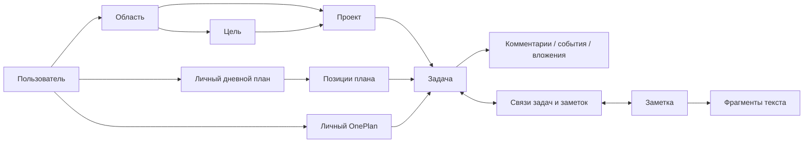
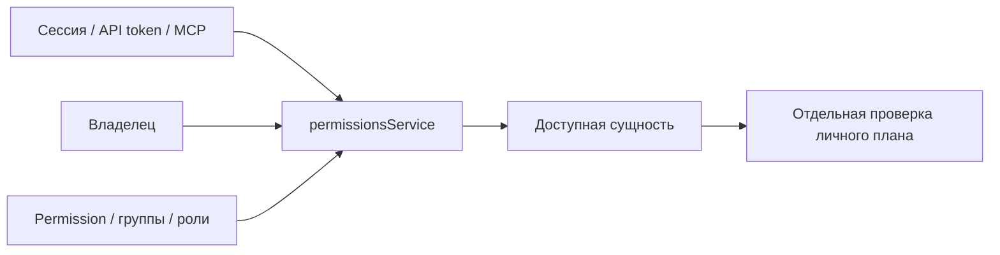

# Модель данных

Состояние и исходная версия — в [индексе](README.md). Поля всех таблиц, типы, обязательность, defaults, индексы, SQL и физические FK перечислены в [каталоге](schema/sqlite.json). Диаграмма ниже концептуальная: отсутствие линии не означает отсутствие FK.

## Основные сущности и владение

| Сущность | Смысл и важные поля | Источник |
|---|---|---|
| User | Владелец, timezone, настройки; `one_actor`, `one_plan_revision` для расширения | `backend/models/user.js` |
| Area / Goal / Project | Область, цель, проект; `user_id`, `area_id`, `goal_id` | `backend/models/{area,goal,project}.js` |
| Task | `uid`, владелец, статус, проект/контекст, `due_date`, `due_has_time`, `defer_until`, параметры повторов | `backend/models/task.js` |
| DailyPlan / DailyPlanItem | Личный день, версия, старт; позиции, задача, время, длительность | `backend/models/daily_plan*.js` |
| OnePlan | Пара пользователь–задача; `planned`, `week`, `last_planned`, `moves`, `revision` | `backend/models/one_plan.js` |
| Note | Текст, проект/ярлыки, вид, готовность, версия, `discussion_date` | `backend/models/note.js` |
| TaskNoteLink | Типизированная двусторонне видимая связь задачи и заметки; уникальная тройка | `backend/models/task_note_link.js` |
| NoteFragment | Цитата/окружение, исходные и текущие позиции, версия, состояние, хеш | `backend/models/note_fragment.js` |
| TaskRelation | Связи задач между собой | `backend/models/task_relation.js` |
| Comment / TaskEvent | Обсуждение с авторами/ответами; журнал изменений | `backend/models/{comment,task_event}.js` |
| task_context_history | Прежний контекст при автоматической смене; создаётся миграцией, модели нет | миграция `20261023000001` |

Физический FK обеспечивает существование ссылки, но не заменяет проверку доступа. `user_id` обозначает владение; совместный доступ к проекту не передаёт чужой личный план.

Проверки доступа: `backend/services/permissionsService.js`; ассоциации: `backend/models/index.js`. Полный каталог также включает служебные сущности авторизации, календарей/CalDAV, привычек, уведомлений, биллинга, групп, порядка списков, inbox и настроек. Наличие таблицы не означает включённую интеграцию или передачу её полей в One.

## Строгий контекст

Проект имеет одну необязательную цель и одну необязательную область. Проект без цели допустим. Две цели у одного проекта текущая модель не поддерживает. Задача в проекте наследует его область и цель; без проекта задаёт их напрямую. При переносе контекст меняется, при снятии проекта остаётся последний контекст. Автоматически заменённые значения сохраняются в `task_context_history`.

Эту гарантию обеспечивают сервисные проверки и SQL-триггеры миграции `20261023000001-strict-task-project-context.js`; одна ORM-ассоциация её не обеспечивает. Не следует путать основной контекст проекта с дополнительными пользовательскими размещениями/порядком проектов.

## Границы

- `backend/modules/tasks`: штатные операции, даты, статусы, повторы; `daily-plan`: порядок и время дня.
- `backend/extensions/one`: совместимость, личные планы/счётчики, роли обсуждения и защита версий. Проверенный контракт планирования расширения ограничен SQLite.
- `backend/modules/notes` и сервисы связей: заметки и фрагменты. Дата обсуждения — метаданные заметки, не срок задачи. При изменении текста фрагмент переопределяется по цитате/окружению; потерянный или неоднозначный фрагмент нельзя молча перенаправлять.
- Внешний адаптер One находится вне этого репозитория. Его конфигурация, checkpoint и документы здесь не хранятся. Заметки/вложения и существующие связи задач имеют собственный контракт обмена; новые TaskNoteLink/NoteFragment не следует считать экспортируемыми без отдельного подтверждения.
- SQLite FK/триггеры и миграции — физический уровень. ORM sync и цепочка миграций не взаимозаменяемы; исправление обнаруженного расхождения описано в [проверках установки](../clean-install-validation.md).
