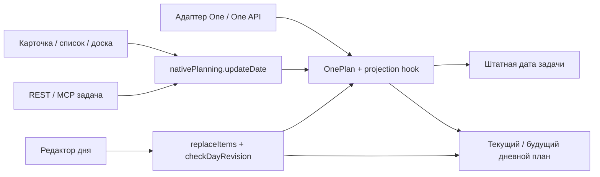

# Контракт планирования

«Сегодня» — основное место работы; «Предстоящие» — штатная доска дней выбранного диапазона. Нового недельного экрана и второй даты задачи нет. Дата обсуждения заметки не участвует в планировании задач.

| Хранилище | Ответственность |
|---|---|
| `Task.due_date` + `due_has_time` | Единственная штатная дата задачи; календарный день определяется в timezone пользователя |
| `DailyPlan` / `DailyPlanItem` | Личный порядок, время начала и длительность работы в конкретный день; прошлые дни сохраняются как история |
| `OnePlan` | Совместимость One, `planned` либо `week`, последняя конкретная дата, счётчик и версия |
| `Task.defer_until` | Штатное откладывание видимости/доступности; отдельное от даты поле, не дополнительный пользовательский «рабочий план» |

Старое `week` означает только неделю: не назначаем понедельник или иной выдуманный день. Новые интерфейсы работают со штатной датой. Одновременно задавать `planned` и `week` нельзя. Подготовка старых планов (`nativePlanning.reconcile`) идемпотентна; конфликт двух существующих конкретных дат прерывает всю транзакцию.

Это схема путей, не бесконечный цикл: проектирование обратной записи ограничено сравнением даты и флагами hooks. Все пути должны пользоваться сервисами/проверенными hooks; произвольный SQL не является поддерживаемым API.

## Запись и конкуренция

| Путь | Атомарность и проверка версии | Граница гарантии |
|---|---|---|
| Карточка/список, REST изменения задачи, перенос доски | `nativePlanning.updateDate`: транзакция; для One-пользователя изменение дня через `planning.change` в ней же; очередь записей SQLite | CAS даты только если передан `expected_due_date`; `expected_due_time` дополнительно защищает время. Старая доска получает 409. Нельзя обещать CAS каждому произвольному клиенту |
| Дневной редактор | `daily-plan/repository.replaceItems` / `clearPlan`: одна транзакция для версии, One-проекции и списка | У One-пользователя обязательны `expected_revision` и `expected_one_revision`; отсутствующие — 428, устаревшие — конфликт |
| One API / MCP планирование | `planning.set`: очередь + SQLite IMMEDIATE; `OnePlan.revision` проверяется при обновлении | Требуется `expected_revision`; нет ревизии — 428; конфликт не перезаписывает новый план |
| Прежний адаптер, транзакционная запись OnePlan | Model hooks вызывают `nativePlanning.project` в той же транзакции | Совместимость подтверждена тестом прямой транзакционной записи. CAS внешнего адаптера принадлежит также внешнему шлюзу; нельзя гарантировать его одним FK |

Источники: `backend/extensions/one/{planning,nativePlanning,write}.js`, `backend/models/one_plan.js`, `backend/modules/daily-plan/{repository,controller}.js`. MCP имеет несколько инструментов: обычная операция задачи и специальное планирование проходят разными сервисными путями. Один транспорт не означает одну проверку версии.

Проекция убирает задачу из других текущих/будущих личных дневных планов, но не стирает исторические. Время и порядок дня — не основание считать ещё один перенос. Не всякий пользователь имеет `one_actor`: гарантии расширения и его обязательные ревизии нельзя распространять на всех пользователей upstream.

## Счётчик

Формула в `planning.change`: добавить 1, только если выбран конкретный день, прежний `last_planned` существует, отличается от нового дня и операция не является автоматическим переходом повторения. Уточнение #11 проверено в отдельной ветке; см. [отчёт исправлений](../issue11-planning-fixes-20261023.md).

| Действие | Прибавка |
|---|---|
| Первое назначение дня | 0 |
| Повторное сохранение того же дня | 0 |
| Другой конкретный день, включая перенос из прошлого | 1 |
| Изменение только времени в том же дне | 0 |
| Очистка даты / выбор только недели | 0, последняя конкретная дата помнится |
| После очистки снова последняя конкретная дата | 0 |
| После очистки иной конкретный день | 1 |
| Изменение только `defer_until` | Не вызывает этот путь изменения даты и само не увеличивает счётчик |
| Завершение/пропуск occurrence с переходом к следующему | 0; дата, OnePlan и дневной план переходят вместе, прежнее значение moves сохраняется |

Завершение и повторное открытие не являются ручным переносом даты. По согласованному правилу #11 автоматическое следующее повторение также не является переносом: REST, MCP и сервис используют общий путь согласования даты/проекций с отключённым увеличением moves. Последующая ручная смена дня снова считается обычным переносом. Сервер определяет автоматический переход сам; одноимённый параметр клиента не отключает счётчик. Полное покрытие всех календарных комбинаций по-прежнему не заявляется.

Транзакционные instance-записи OnePlan от прежнего адаптера теперь повышают `User.one_plan_revision` через model hooks: это делает устаревшим также снимок ещё не существовавшего дня. Штатный `planning.change` сохраняет собственное однократное повышение общей ревизии. Версии и проекции меняются в той же транзакции, что и запись плана; изменения сырым SQL в обход hooks не являются поддерживаемым контрактом.

Экспорт/импорт сохраняет точность день/неделя и историю счётчика. Пропавшая запись при обмене не разрешает удаление; конфликты требуют разбора. Живую синхронизацию с One в этой проверке не запускали.
